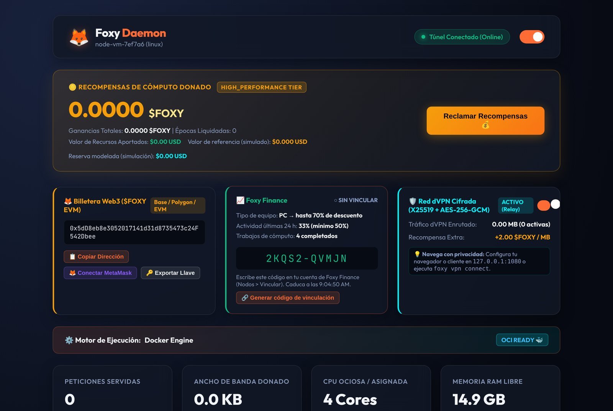
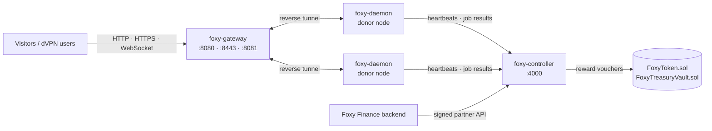

<div align="center">

# 🦊 Foxy Network

**Open-source DePIN: share your idle CPU and bandwidth, host web apps at the edge, run an encrypted dVPN, and earn `$FOXY` rewards.**

[](https://github.com/IAmMRPrince/Foxy-Network/actions/workflows/ci.yml)
[](LICENSE)
[](package.json)
[](SECURITY.md)

**English** · [Español](README.es.md) · [Website](https://iammrprince.github.io/Foxy-Network/)



</div>

## What is Foxy Network?

Foxy Network is a **decentralized physical infrastructure network (DePIN)** written in Node.js. Anyone with a Windows, macOS or Linux machine runs a lightweight **donor node** that contributes spare resources to the network:

- **Edge hosting** — serve web apps through reverse tunnels, no open ports or public IP needed.
- **Decentralized VPN (dVPN)** — route other users' traffic through your connection, encrypted end to end between client and exit node.
- **Distributed compute** — run verified jobs (Monte Carlo risk simulations, linear algebra, latency probes) for partner platforms such as **Foxy Finance**.

Every contribution is metered and settled every 30 seconds in **`$FOXY`**, an ERC-20 token claimable on any EVM chain (Base, Polygon, Arbitrum…).

> ⚠️ **Prototype (v0.2).** It runs locally and has an automated test suite, but it has **not** been externally audited and no contract is deployed on mainnet. Read [`SECURITY.md`](SECURITY.md) before using it with real funds or data.

## Quick start

Requires [Node.js 20+](https://nodejs.org/).

```bash
git clone https://github.com/IAmMRPrince/Foxy-Network.git
```

```bash
cd Foxy-Network
```

```bash
npm install
```

```bash
npm start
```

`npm start` launches the gateway, the controller, a donor node, the local dVPN proxy and a Foxy Finance demo that submits real compute jobs. Then open:

| What | URL |
| :--- | :--- |
| Donor dashboard | http://localhost:4040 |
| Gateway portal | http://localhost:8080 |
| Demo app served through a tunnel | http://localhost:8080/t/foxy-demo-app/ |
| Controller | http://localhost:4000 |

Run the test suite with `npm test`.

## Features

| | |
| :--- | :--- |
| 🖥️ **Cross-platform donor node** | Windows (tray and silent modes), macOS and Linux (systemd / launchd service). Local dashboard bound to `127.0.0.1` with a session token. |
| 🌐 **Reverse tunnels** | Expose apps by subdomain or path, with failover to another node when one goes offline. Static, Python, Node.js and Docker/Podman workloads. |
| 🛡️ **Encrypted dVPN** | Per-session X25519 key exchange + AES-256-GCM. Exit nodes only reach public addresses on web ports, never the donor's LAN. |
| 🧮 **Verified compute jobs** | A fixed job catalogue (no remote code). Jobs can run on 2–3 nodes; only nodes whose results agree get paid. |
| 🪙 **`$FOXY` rewards** | Uptime, bandwidth, dVPN traffic and compute units, settled every 30 s. The oracle signs vouchers redeemable on-chain. |
| 🔐 **Built-in Web3 wallet** | Auto-generated EVM wallet, or plug in your MetaMask address. |
| 🌍 **`.fox` domains** | Local DNS + HTTPS for `www.foxynetwork.fox`, `www.foxyfinance.fox` and `<app>.foxynetwork.fox`. |
| 🐍 **Partner SDKs** | HMAC-signed partner API with ready-made clients in JavaScript and Python. |

## Architecture



| Package | Role |
| :--- | :--- |
| [`foxy-daemon`](packages/foxy-daemon) | Donor node: dashboard, workloads, wallet, dVPN exit relay, compute jobs |
| [`foxy-gateway`](packages/foxy-gateway) | Public ingress: routes requests and dVPN sessions to tunnels, `.fox` domains |
| [`foxy-controller`](packages/foxy-controller) | Control plane: node registry, rewards ledger, oracle, partner API |
| [`foxy-vpn`](packages/foxy-vpn) | dVPN client proxy (`127.0.0.1:1080`), exit relay and tunnel crypto |
| [`foxy-jobs`](packages/foxy-jobs) | Deterministic compute job catalogue |
| [`foxy-contracts`](packages/foxy-contracts) | `FoxyToken` (ERC-20, proof-of-contribution mint) and `FoxyTreasuryVault` |
| [`foxy-security`](packages/foxy-security) | Signed tokens, request signing, secret storage, Ed25519 identities |
| [`foxy-cli`](packages/foxy-cli) | `foxy` command line |

## Earn `$FOXY`

Rewards are settled every 30-second epoch:

| Contribution | Reward |
| :--- | :--- |
| Uptime | 0.25 `$FOXY` / minute |
| Web bandwidth served | 1.50 `$FOXY` / MB |
| dVPN traffic relayed | 2.00 `$FOXY` / MB |
| Verified compute unit | 3.50 `$FOXY` / unit |

Hardware multipliers: 1.0× standard, 1.5× high performance, 2.0× ultra compute. Without a configured token contract (`FOXY_TOKEN_ADDRESS`) claims run in **simulation mode** and no real tokens move. `$FOXY` has no guaranteed price.

## Use the dVPN

```bash
node packages/foxy-cli/bin/foxy.js vpn connect
```

Point your browser to the HTTP proxy `127.0.0.1:1080`, or test from a terminal:

```bash
curl -x http://127.0.0.1:1080 https://api.ipify.org
```

Known limitation: the key exchange is not yet authenticated against the exit node's identity, so a malicious gateway could actively intercept non-HTTPS traffic. HTTPS traffic stays protected by its own TLS.

## Foxy Finance integration

Foxy Network is the infrastructure layer for **Foxy Finance**, a quantitative trading platform. Donors link their node to their Foxy Finance account with a one-time code and get a subscription discount based on the hardware they contribute:

| Device | Discount |
| :--- | :--- |
| Android phone (Termux) | 25 % |
| Raspberry Pi / SBC | 50 % |
| PC / laptop | 70 % |
| VPS / bare metal (≥ 4 cores, ≥ 8 GB) | 100 % — Pro Quant plan |

Foxy Finance offloads risk simulations to the network and pays per verified compute unit. Integration guide and SDKs: [`docs/FOXY_FINANCE_INTEGRATION.md`](docs/FOXY_FINANCE_INTEGRATION.md).

## CLI

```bash
node packages/foxy-cli/bin/foxy.js help
```

`status` · `nodes` · `deploy <subdomain>` · `vpn [status|connect]` · `balance` · `claim [address]` · `link` · `finance [status|pay|dispatch]` · `domains [list|setup]` · `token`

## Roadmap

- Gateway-side bandwidth metering (bandwidth is currently self-reported, with a per-heartbeat cap)
- Authenticated dVPN key exchange bound to node identities
- Testnet deployment of `FoxyToken` and `FoxyTreasuryVault`, then an external audit
- Lighter node for phones and single-board computers

## Contributing

Issues and pull requests are welcome — see [`CONTRIBUTING.md`](CONTRIBUTING.md). Report vulnerabilities privately as described in [`SECURITY.md`](SECURITY.md).

## License

[Apache-2.0](LICENSE)
